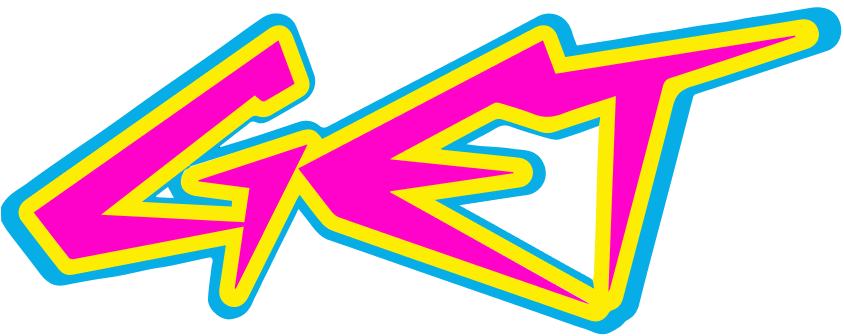

  

  <h1>Welcome to your GET case 👋</h1>

  

    <strong>GET (Gall & Etos Technology)</strong> builds the software behind
    <a href="https://www.etos.nl">Etos</a> and <a href="https://www.gall.nl">Gall & Gall</a>,
    part of Ahold Delhaize.
  

---

If you are reading this, you have been invited to do a technical case with us. Thank you for your time and
interest; we're looking forward to building something together.

This page explains how the case works, what we look for and how to prepare. The case itself lives in the
private repository we shared with you.

## 🛒 Who we are

Etos and Gall & Gall have hundreds of stores across the Netherlands, plus webshops and apps. GET is the tech
organisation behind them: product teams that build and run the services for products, prices, promotions,
stores, suppliers and the tools our colleagues use every day.

We combine the stability of a large enterprise with the pace of two smaller retailers. Teams own their
services end to end, from idea to production.

| Area           | What we use                                                     |
| -------------- | --------------------------------------------------------------- |
| Backend        | Python, FastAPI, Strawberry GraphQL, SQLAlchemy, `uv`           |
| Frontend       | React, Vite, Next.js, Tailwind, shadcn/ui                       |
| Data & events  | PostgreSQL, Redis, Kafka                                        |
| Platform       | Docker, Kubernetes, Azure, GitHub Actions, Grafana              |

You don't need to know all of these. We care much more about how you work than about which tools you have used.

## 🧩 How the case works

The case is a small, realistic application from our retail domain. It comes with working code to build on and
everything you need to run it on your own machine.

1. **Invitation.** We create a private repository in this organisation just for you and invite you to it.
   Accept the invitation from your email or from [github.com/notifications](https://github.com/notifications).
2. **Preparation.** Clone the repository and get the stack running before the session (see
   [Preparing](#-preparing)). Feel free to read the README and look around the code.
3. **The session.** We work on the case together in your repository, starting from its README. You drive;
   your interviewer is there to answer questions, discuss choices and pair with you.

The case is split into phases, and the README shows which ones apply to your level.
**We don't expect you to finish everything.** Doing a few phases well is better than rushing through all of
them.

## 🛠️ Preparing

Make sure you have the following on the machine you will use for the session:

- [ ] Git, and access to your case repository on GitHub
- [ ] [Docker](https://docs.docker.com/get-docker/) with Compose **v2.22 or newer** (`docker compose version`)
- [ ] Your favourite editor or IDE, set up the way you like it
- [ ] An AI coding agent (harness), installed, logged in and tried out on a small task

We build with AI every day, and we expect you to use an AI coding agent during the case: a tool that can read
your repository, run commands and make changes for you. If you don't have a favourite yet, pick one of these:

- [Claude Code](https://claude.com/product/claude-code)
- [Codex](https://github.com/openai/codex)
- [GitHub Copilot app](https://docs.github.com/en/copilot/concepts/copilot-surfaces/github-copilot-app)

Make sure you understand what your agent produces: we will ask you about it.

Then clone your repository and start the stack as described in its README. If it doesn't start, let us know
before the session so we can sort it out together.

## 🔒 Good to know

- Your repository is private: only you and the GET people involved in your process can see it.
- Please don't share the case or publish your solution.

---

  Good luck, and above all: have fun building! 🚀

